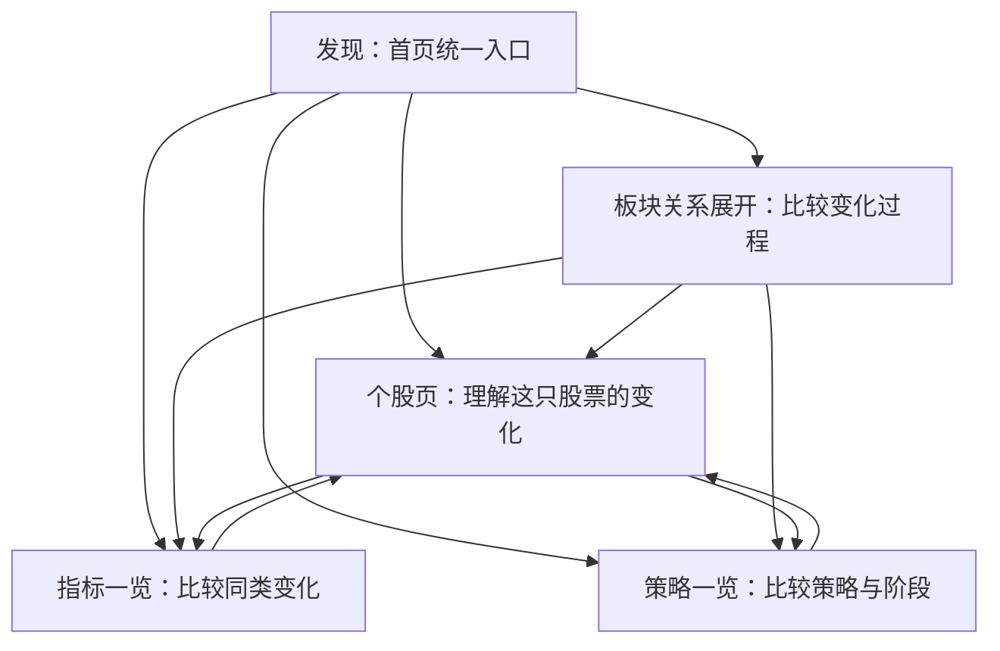

# Urus 变化发现与分析页面改造方案

日期：2026-09-20。状态：第一个可用闭环已在 `codex/system-refactor-2` 实现，尚未部署；持续板块关系仍受连续同口径历史不足约束。依据：用户本轮明确目标、现网站只读检查及当前代码。本文不改变现有运行配置、策略规则或部署。

## 1. 产品目标与交付边界

帮助注意力有限的用户发现值得重新判断的市场变化：观察板块启动线索与板块间的强弱交替；发现扫描范围内尚未重点关注、但指标或策略出现重要变化的股票。一个入口承接发现，再引导到个股解释或指标／策略横向比较。

完整阅读路径：此前如何 → 新变化是什么 → 为什么值得现在看 → 有哪些反对证据 → 进入详情核对 → 后续是否延续或被否定。

个股页保留全部独立策略并扩大算法建议；横截面保留主动探索能力，不能只显示算法筛选结果。发现的优先级表示值得检查的程度，不代表方向、买入建议或获利概率。

## 2. 现状核查

检查地址：https://urus.yimeinforge.com/ 、/indicators、/strategies、/groups。

- `/` 当前直接渲染个股页；本次打开默认 INTC。用户一进站就进入已选股票，缺少跨市场的变化入口。
- 个股页前面依次出现最终行动、结构／变化／setup、独立当前日线机会；算法建议位于图表旁的窄侧栏，每个策略默认仅显示第一条理由。关键解释空间小，重复摘要空间大。
- 指标和策略扫描页在展示个股之前有大标题、指标标签、统计条、说明、来源版本、组级标题和分布。关键股票需要向下找；变化列表在全部组之后。
- 后端已有按状态转换和阈值接近程度的默认排序，但 UI 没有可见的排序理由与切换控件，分组又切断了整体顺序。因此应改善排序表达与控制，不能简单宣称当前完全没有排序。
- 同一股票在多个组重复渲染。指标页此次显示 78 条组成员记录，不能把它直接解释成 78 只独立股票；NTRA 的同一次状态变化也在不同组重复列出。
- 策略扫描以 `trend_momentum_v1` 等实现标识作主标题；默认展示阶段和分数，核心支持条件与反对条件不够直接。
- 本次查看个股最新日线为 9 月 18 日，扫描／组观察采用 9 月 16 日的 Observation Run。页面之间必须显式传递证据日期与身份。日期差异的原因未在本次只读检查中诊断。
- 现有组内轮动图是组内股票的相对强弱分布，并非跨板块关系的时间检测；其 5D 与 20D 的差也不能直接当作同一指标较前日的变化。
- 当前“指标推荐”组来自 Universe 中启用的 equity_watchlist 角色，不等于已经有了独立的个人重点关注状态或全市场扫描。

## 3. 信息架构与跳转

保留已有入口和收藏链接，默认首页改为“发现”。导航：发现｜指标一览｜策略一览｜板块观察；收盘运行与标的配置归入次级工具入口。个股通过搜索、重点关注或发现记录进入。

每次跳转携带发现身份、当前与对比交易日、Run、Dataset、股票／板块、指标／策略、筛选和排序。目的页在相同证据上高亮相关行或展开对应策略。返回时恢复列表位置；有更新证据时展示切换入口，不能自动覆盖发现当时的理由。

## 4. 首页：变化工作台

### 4.1 布局

1. 紧凑页头：发现、搜索、证据交易日、对比交易日、扫描覆盖；技术 hash 放入详情。
2. 本次值得查看：默认约 6–10 条精选变化，数量仅为布局起点，没有足够变化时不凑数。统一队列中使用“板块变化／板块关系／个股变化”标记。
3. 筛选：全部、板块与关系、未重点关注、我的重点关注；另有新增／重要更新／延续／已结束切换。默认突出新增和重要更新，延续记录保留但收起。
4. 右侧可选窄栏：我的重点关注发生的变化、暂存的候选。只在足够宽的屏幕出现；其内容与主队列共用记录，不重复计数。
5. 全部变化：按需展开或分页，允许用户检查未进入精选的记录及其排序原因。

不另建三套独立排行榜。板块关系与相关个股发现互相链接，聚合到一条主记录时仍显示子候选数量与各自理由。

### 4.2 每条记录

固定信息结构：

| 字段 | 用户读到的内容 |
| --- | --- |
| 对象与变化标题 | 股票、板块或板块对，以及明确的变化事实 |
| 此前 → 当前 | 同一指标或策略在两个可比日期的值／状态 |
| 值得查看的理由 | 最多 2–3 条关键证据，能够点击核对 |
| 反对证据／待确认 | 哪些条件仍未满足、哪些表现不支持该解释 |
| 时间与进展 | 首次出现、最近实质更新、延续交易日数 |
| 关注关系 | 未重点关注／已重点关注，与扫描资格分开 |
| 下一步 | 看个股、比较同类、查看板块关系 |

只有具体数值变化但没有足够解释时，显示观察事实，不生成“板块启动”一类更强结论。

### 4.3 排序与避免噪声

先检查可比性和数据资格，再排序。精选分层优先显示重点关注对象原有理由被否定的变化，以及未重点关注对象的新发现／重大更新；其他变化随后展示。两类内容保持可见，避免大量风险更新完全挤掉新发现。

层内依次参考事件重要程度、是否新增独立证据、变化相对自身历史的幅度、发生时间；最后用稳定对象标识打破并列。排序标签应可读，如“首次出现”“新增量能证据”“原条件失效”。默认不展示含义不明的 0–100 综合分。

连续多日状态不变不算新发现；阈值附近来回切换需要持续性／滞回规则；新数据入库、补历史、改策略版本不算市场突变。变化显著性、持续窗口和降噪阈值作为有版本的规则，通过历史逐日回放后确定，不在设计阶段宣称已经有效。

同一股票同一事件在多个观察组出现时合并，并保留全部组标签。同一个指标引出的多个近义条件不算多个独立确认；一只股票的不同策略可分别保留证据，并归在同一对象下。方向相反或时间跨度不同的事件不能盲目合并。

“已看”只记录本条事件的本次修订；新实质变化仍显示为未读。“暂时忽略”仅压低此事件的重复显示，有期限且可恢复；不得屏蔽新的失效等不同事件。

## 5. 板块启动与跷跷板如何落地

### 5.1 比较对象先明确

当前主题组可能混有 ETF、个股和跨主题成员。固定区分板块代理 ETF、主题观察篮子和市场／跨资产参考；不把它们当作同类样本直接混排。

- ETF 作为参考线，不当作另一只成分股参与个股广度计数。
- 自选篮子的观察只能表述为“所覆盖成员的变化”，不能冒充整个行业。
- 单股票组保留个股线索，不能升级成板块启动发现。小样本组标出样本限制。
- 跨板块比较统一日期、复权口径、权重方法及市场基准。保留原有个股行业基准，但不直接混比相对不同基准的数值。
- 成员调整引起的组指标变化与价格变化分开；重叠成员的影响可展开核对。

### 5.2 初始事件类型

| 类型 | 形成记录的依据 | 展开后核对 |
| --- | --- | --- |
| 原先落后开始改善 | 同一板块相对自身此前阶段有可持续变化，并有成员层面的佐证 | 哪些成员先变、是否只由一只股票驱动 |
| 变化开始扩散 | 新参与成员增加，原有个股线索得到更多成员支持 | 新加入与未跟随成员、固定样本下的变化 |
| 领先关系改变 | A 与 B 的相对表现差从原有方向持续收窄或反转 | 两者时间线、相对收益差、起止日期 |
| 反向强弱关系出现／减弱 | 多个可比时点出现 A 改善 B 转弱，或原关系不再成立 | 同期市场因素、是否只有单日偶然反向 |

“领先切换”与“反向强弱”分开：A、B 同时上涨也可能发生领先切换。不能用短期负相关自动命名跷跷板，更不能从价格关系推断资金实际转移。

关系展开默认给同一时间轴上的 A、B 与共同市场参考，另给 A/B 相对表现差和关键变化日期。先说明现象，再展示支持／不支持成员。用户可直接打开筛选好的指标或策略表，而不必先进入单独的组工作台。

对全部可比板块对可做后台观察，但首页只呈现有足够支持的变化。多个关系共享同一板块时合并叙述、保留具体关系，防止组合数量淹没首页。关系阈值需要时间外验证，避免从大量配对里挑偶然结果。

## 6. 未重点关注股票的发现

引入独立的个人重点关注列表：加入／移出不会改变 Universe 采集资格，不从浏览一次页面推断用户关注，也不自动重写现有 equity_watchlist。

先覆盖已经采集的股票，发现其中未重点关注的对象。若覆盖不足，再依据现有额度准入机制扩大扫描池；页面始终显示实际覆盖、缺失和待采集数量，不声称已扫描全市场。

发现同时支持：策略新确认／接近确认／失效，指标跨越条件，以及尚未跨阈值但相对自身历史出现显著改善的组合。RSI 从 42 到 56 仍属同一状态，也可能与相对强弱、量价变化组成值得检查的事件；不能只复用当前 transitions。

单项极端值、方向变化、独立证据增强是不同含义。量比大不天然偏多，超卖不天然转强；每条记录说明方向、上下文和未满足条件。历史波动、流动性、数据修订等影响在规则设计中处理。

生命周期：首次发现 → 延续观察 → 增强／减弱 → 条件失效或观察结束。完整记录仍可查阅，退出精选时提供原因。判断资格丢失标为暂不可评估，不伪装成失效。新加入扫描池、无历史对照的股票显示首次覆盖，不能冒充今天突变。

## 7. 个股页重排

桌面：压缩永久左侧树为可收起导航；顶部行情与证据日期一行；紧接全宽算法建议，然后全宽图表与证据。算法建议不再放窄栏。

建议区内部，足够宽时约 60% 放判断与策略解释，40% 放变化时间线和与相关板块的联系；窄屏改为纵向。图表提供定位和展开，不牺牲图表本身的可用尺寸。

### 7.1 算法建议默认可见内容

1. 若从发现进入：说明本次为何被选中，并保留当时证据日期。直接搜索进入则显示最近一次有意义变化或当前状态。
2. 综合解释：哪些策略支持，哪些不支持，是否处于不同时间跨度；保留冲突，不机械多数表决。
3. 策略表：策略名称、方向／阶段、此前 → 当前、关键支持、未满足条件、后续确认／失效。默认完整显示最相关的数条，其余可一键展开；当前仅 5 个策略时优先在紧凑表中全部列出。
4. 排序：来自发现的策略优先，其次近期重要变化、有效且相关的策略、其他可评估策略、无形态／不适用／证据不足。方向和阶段分开，偏空已确认不能当作买入优先级。

点击策略就地展开全部理由与规则证据，并联动图表；无需去横截面才能补齐本股票解释。点击某指标的“横向比较”才进入带筛选的扫描页。

删除独立“当前日线机会”主模块，将仍有用的计划归属到对应的明确策略／规则族下。现有突破机会引擎和 `breakout_volume_v1` 可能不是同一规则，必须先核对身份，不能只因名称相近而合并结论。

“最终行动”改为更准确的“当前判断”，与算法建议整合，避免多份摘要。形成日、生效日、失效线等仅在适用策略中出现。`ma20 >= …` 等条件用中文解释实际比较对象；指标阈值不能假装成股票触发价。

当前事实并入对应证据；历史复盘与技术追溯折叠。AI 辅助保持主动调用，入口靠近算法建议；发现和解释的基础能力不依赖每次发起 AI。期权保持独立区块，不抢占日线解释的首屏位置。

## 8. 指标／策略一览页重排

共用紧凑的比较工作台，保留两个清晰入口和稳定独立路由。顶部：日期／对比日期、搜索、板块、重点关注、状态、排序。筛选栏与表头滚动固定，排序名称和方向始终可见。

默认按股票去重展示，板块作为标签和筛选项；可主动切换按板块分组。不同基准／数据集下的值不可强行去重成一个数，必须保留上下文或分开比较。

### 指标视图

- “综合矩阵”：股票 × 少量核心指标，显示当前状态、变化标记；便于快速发现多个证据同时改变。
- “单指标详情”：股票、板块、前值、当前值、变化量、状态变化、离条件的距离、简短时间轨迹。
- 提供新变化、变化幅度、当前值、距条件远近、代码等显式排序。
- 指标间的原始数值不可混排；跨股票比较 MACD 等受价格尺度影响的量需适当标准化并说明口径；超买／超卖及改善方向不能简单统一为数值越高越好。

### 策略视图

- 默认中文策略名；版本和实现 ID 收进说明。
- 概览矩阵：股票 × 策略，单元格显示方向与阶段以及变化标记。
- 单策略列表：股票、此前 → 当前、方向、关键理由、未满足条件、确认／失效、发生时间。
- 允许按新确认、接近确认、原条件失效、阶段变化、同一策略的分数变化排序；异构策略分数不合成跨策略胜率或总排名。
- 状态变化文字区分改善、退步、方向改变、条件失效；禁止所有变化共用向上箭头。

组分布图保留为可展开辅助视图，数据版本和 hash 放入来源面板。列表默认显示有数据的对象，缺失项以可展开计数保留。表格缺值不使用会暗示连续性的插值。

视觉密度以常见 1440×900 桌面为首轮验收：标题与工具区约 160–200px 内，首屏至少约 8 行可用比较内容；正文 13–14px 起，减少重复边框与空白，不靠缩小字体达成密度。平板折叠筛选、固定股票列；手机优先对象与变化理由，详情按需展开。

## 9. 数据与实现边界

复用冻结 Dataset、Observation Run、CrossSectionProjection 的前后值和理由、Group Snapshot 的广度与相对强弱、Strategy Decision 及图表投影。

新增逻辑：

- 发现投影：稳定事件身份、规则版本、对象、当前／对比证据、首次出现与最近实质变化时间、变化类型、支持与反对证据、生命周期、排序分项、目标链接。
- 板块关系投影：板块对、共同口径与日期、时间序列、关系事件、样本与重叠信息。不可直接把现有 rotation 散点改名使用。
- 用户关注与阅读状态：与客观发现分开存储；不改变冻结事实。个人排序基于客观发现和关注偏好生成，不污染共有的市场证据。

事件历史按观察时点追加，不能因后来行情改写最初记录。回放重建的结果与当时实际生成的记录分开标记。规则／样本／复权口径变化打断比较或重建可比链，不能制造假信号；同日重试保持幂等。

开页读取预计算结果；页面不触发广泛采集或每股历史回放。个人关注操作用独立写入接口。保持现有收市观察主链和外部采集额度限制，发现失败有独立状态，不能把部分生成结果当完整扫描。

### 建议代码落点

| 范围 | 改造 |
| --- | --- |
| router、AppShell | 首页发现与上下文跳转；保留旧路由 |
| 新 DiscoveryView | 变化队列、筛选、生命周期与关注操作 |
| InstrumentDecisionView | 算法建议升为主内容、策略证据整合 |
| CrossSectionView 与两个 wrapper | 紧凑表格／矩阵、排序筛选、去重、定位 |
| GroupObservationView | 复用组证据，增加同口径关系比较入口 |
| 后端 cross_section、group_phase 等 | 复用原始事实；补显著变化与关系投影 |
| 后端新 discovery 模块及用户状态存储 | 事件生成、版本、生命周期、个人关注 |

## 10. 实施顺序与验收

### 阶段一：建立贯通的最小闭环

在现有扫描范围内选一类策略变化和一类指标变化，完成冻结事件 → 首页记录 → 定位个股策略／横向表行 → 返回列表。同步做个股建议区重排、扫描页表格排序及重点关注状态。此阶段不能假装已完成跨板块跷跷板发现。

### 阶段二：完成两类核心发现

增加同一状态内的显著变化、板块阶段变化、板块关系变化；补样本口径、去重、持续观察、失效退出与降噪。用真实历史逐日回放评估重复率、发现数量、变化是否只是数据修订或样本变化。

### 阶段三：扩展覆盖与优化

依据数据能力扩大扫描范围；调整精选数量和排序，完善移动端与搜索。规则调整通过版本发布，保留旧记录解释能力。

### 必须通过的验收场景

1. 未重点关注股票产生重要变化后，可从首页一次点击进入有相同证据的个股解释，另一次可进入同类比较；无需重选日期和策略。
2. 某股票连续五天没有实质变化时仅保留延续记录；新增独立证据或条件失效时产生可读更新。
3. 同一股票属于多个主题，不重复计入精选数量或独立股票覆盖；确有不同口径的结果保留差异。
4. 板块同时上涨但领先反转，展示领先变化；只有一天反向不升级成稳定跷跷板关系。
5. 单股票板块、缺失日期、成员调整、ETF 混入、基准不同均不会产生虚假的板块结论。
6. 个股页首屏能读到为何关注、关键支持与反对证据；策略详情不必绕去扫描页才看全。
7. 指标／策略页排序可见、可切换、稳定；退步不用向上箭头；未命中过滤条件仍可通过全部视图查询。
8. 首页采用 9 月 16 日 Run 而某个股有 9 月 18 日证据时，跳转仍先核对 9 月 16 日发现，另提供切换最新入口。
9. 无新增变化、无可比历史、数据过时、正在采集、部分完成和请求失败分别显示，不用零变化冒充缺数据。
10. 离线评估同时报告事件重复率、无效变化来源、精选拥挤程度、用户查看后加入重点关注的情况与漏检复查；不把点击率或后续涨幅单独当质量指标。

产品与页面规则可按本文推进；信号窗口、阈值、关系显著性和扩展扫描范围需要在实现时用真实覆盖和历史验证确定。本文不把尚未验证的启发式包装成确定性预测能力。
